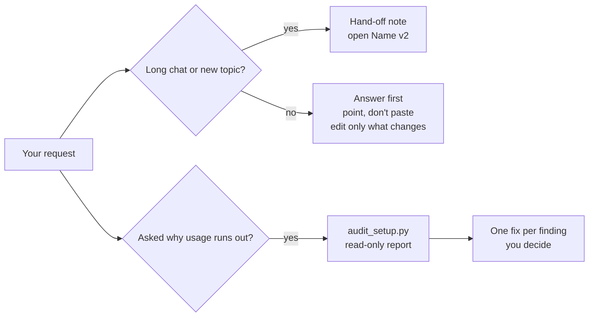

<div align="center">

# token-saver

**Use less of your Claude usage limit — without losing a single source.**
An Agent Skill that keeps answers and work lean, hands off to a fresh chat when a conversation grows long, and audits the setup that quietly loads tokens on every turn.

[](https://github.com/ladansojudi/token-saver/actions/workflows/ci.yml)
[](./LICENSE)
[](https://agentskills.io)
[](https://code.claude.com/docs/en/plugins)

</div>

---

## Why

Every new message sends the whole conversation again. Long chats, large files, repeated text, Research and web search all use your limit faster, and every installed skill adds its description to every turn. Anthropic publishes clear guidance on this, but it is spread across several pages and easy to forget mid-task.

This skill turns that guidance into standing behaviour. Every rule traces to an official page, quoted in [`references/sources.md`](./skills/token-saver/references/sources.md):

| Anthropic guidance | What the skill does |
|---|---|
| *"Refer back to previous information instead of repeating it."* | Points to files and earlier messages instead of pasting them again |
| *"Group them in a single message."* | Asks every clarifying question in one message |
| *"Use `/clear` to start fresh when switching to unrelated work."* | Offers a fresh chat (`Name v1 → v2`) with a 15-line hand-off |
| *"Tool usage (e.g., Research, web search)"* uses more | Says so in one line before a costly step you didn't ask for |
| *"Every skill in the skill listing adds to your context on every turn."* | Audits installed skills, subagents, CLAUDE.md and MCP servers |
| *"Aim to keep CLAUDE.md under 200 lines."* | Flags long CLAUDE.md files |

### What it never cuts

Source links and quotes, "I don't know", checks and tests, anything you asked for, and safety, privacy or accessibility warnings. Saving tokens never means saving on evidence.

## Example

The audit, run on [a deliberately heavy setup](./examples/heavy-setup) ([full report](./examples/heavy-setup/report.md)):

| # | Costs | Finding | Basis |
|---|---|---|---|
| 1 | every turn | Skill `everything-writer`: description is 1,871 characters, over the 1,536 cap | official |
| 2 | every turn | 13 skills listed to Claude on every turn | judgement call |
| 3 | every turn | 5 MCP servers configured | judgement call |
| 4 | every session | `CLAUDE.md` is 262 lines | official |
| 5 | when used | `big-reference` SKILL.md is 620 lines; once loaded it stays in the chat | official |
| 6 | when used | `check-skill` installed both personally and in the project | official |

Each finding comes with one fix. The audit only reads files: it never changes, moves or deletes anything, and it makes no network calls.

## How it works



`SKILL.md` is about 60 lines on purpose: once a skill loads, its text stays in the chat for every later turn. Details live in `references/` and load only when needed.

## Installation

### Claude Code

```text
/plugin marketplace add ladansojudi/token-saver
/plugin install token-saver@token-saver
```

Or put the skill folder in your personal skills folder, so every project on your laptop can use it:

```bash
git clone https://github.com/ladansojudi/token-saver
cp -R token-saver/skills/token-saver ~/.claude/skills/
```

### Claude.ai / Claude desktop app

Download `token-saver.skill` from the [latest release](https://github.com/ladansojudi/token-saver/releases/latest), then upload it in the Skills section of Claude's settings ([help article](https://support.claude.com/en/articles/12512180-using-skills-in-claude)). The audit script needs code execution turned on.

## Usage

No command is needed. The skill applies during long working sessions and whenever you mention usage. Try:

> *"This chat is getting long — what now?"*
> *"My usage runs out really fast. Check my setup."*
> *"Fix the 'Why now' part of brief.md."* — you get the changed part only.

Run the audit yourself:

```bash
python3 ~/.claude/skills/token-saver/scripts/audit_setup.py --home ~ --project .
```

## Repository layout

```
token-saver/
├── .claude-plugin/
│   ├── plugin.json          # Claude Code plugin manifest
│   └── marketplace.json     # lets `/plugin marketplace add` find it
├── skills/token-saver/
│   ├── SKILL.md             # the standing rules (≈60 lines)
│   ├── references/          # sources, hand-off template, audit checks
│   ├── scripts/audit_setup.py
│   └── evals/               # test cases (claude plugin eval format)
├── examples/heavy-setup/    # a setup with every problem, and its report
├── benchmarks/              # measured runs, with replies and verdicts
├── tools/run_evals.py       # with/without runner using headless Claude Code
├── tests/                   # unit tests + SKILL.md validator
└── .github/workflows/ci.yml
```

## Evaluation

Four cases, each with 4–6 graders:

| Case | Checks |
|---|---|
| `handoff-long-chat` | suggests `Desk Research v2`, hand-off ≤ 15 lines, points to files, doesn't redo "Not found" questions |
| `edit-only-changed-part` | changes only the "Why now" section; no full reprint, no preamble |
| `audit-heavy-setup` | finds every problem in the heavy setup, one fix each, touches no file |
| `short-answer-keeps-sources` | short answer that still keeps the source link and the "Not found" |

### First measurement (approximate, 2026-10-31)

One run per case and arm, with the skill loaded vs without it, graded by a blind Claude Haiku judge. Full method, replies and verdicts: [`benchmarks/2026-10-31-approx`](./benchmarks/2026-10-31-approx/README.md).

| | With skill | Without |
|---|---|---|
| Checklist met | **19/20 (95%)** | 13/20 (65%) |
| Tokens, 4 short tasks | 268,341 | 268,211 |
| Reply length | 4,890 characters | 5,964 characters |

- **Better answers, same tokens on short tasks.** Loading the skill costs about 1.5–3.5k tokens on a short task; the setup audit was 9% cheaper with it.
- Small sample, checklists written with the skill, and the skill was told to load. Treat this as a smoke test, not a benchmark.

### Long session (approximate, 2026-10-31)

Ten messages on one project, with and without the skill. The session was run with three versions in turn, each fixing what the previous run showed. Token counts are exact per-request usage from the transcripts. Details: [1.0.0](./benchmarks/2026-10-31-long-session/README.md), [1.1.0](./benchmarks/2026-10-31-long-session-v1.1/README.md), [1.2.0](./benchmarks/2026-10-31-long-session-v1.2/README.md).

| | 1.0.0 | 1.1.0 | **1.2.0** | Without |
|---|---|---|---|---|
| Input tokens, whole session | 1.30M | 1.60M | **1.29M (−12%)** | 1.47M |
| Model requests | 19 | 23 | **18** | 21 |
| Last answer covers every open question, one line each | no | partly | **yes** | yes |
| Blind checklist (of 17) | 12 | 12 | **14, 14** | 13–15 |

- **1.2.0: 12% fewer input tokens, at the same quality** within judge noise. The unchanged baseline files scored between 13 and 15 over four judge runs.
- **What it took to get there:**
  - 1.0.0's fresh chat answered from the hand-off note alone.
  - 1.1.0 fixed that, but handing off a still-small chat cost more than it saved.
  - 1.2.0 offers a fresh chat only once the conversation itself is large, and writes the hand-off without asking first.
- **Not yet measured:** a session long enough for the hand-off to pay off. Price-weighted savings are small (about 5%) because most of each request is cached setup.

### Run the cases yourself

With `claude plugin eval` (in early access; billed model runs):

```bash
cd skills/token-saver && claude plugin eval . --allow-tools Read,Edit,Write,Bash --scaffold
```

Or with headless Claude Code, which also records tokens, time and file changes:

```bash
python3 tools/run_evals.py --out /tmp/token-saver-evals --runs 3 --jobs 4
```

## Development

```bash
python3 tests/validate_skill.py               # frontmatter + link checks
python3 -m unittest discover -s tests -v      # audit script unit tests
claude plugin validate .                      # manifest check
```

## Limitations

- The skill changes how Claude answers and works; it cannot change what a feature costs. Research, web search and long chats still use more.
- An installed skill costs a little on every turn too: its description (about 520 characters here) is in every listing. Uninstall it if you don't use it.
- The audit only reads local files. It can't see claude.ai usage, plugins installed with `/plugin`, or which skills you actually use; `/usage` in Claude Code and **Settings › Usage** in the apps can.
- "More than 10 skills" and "more than 3 MCP servers" are judgement calls, not official limits, and the report says so.

## Contributing

Issues and pull requests are welcome. For a behaviour change, please add or update a case in `skills/token-saver/evals/` that shows it, and a quote in `references/sources.md` for any new rule.

## License

[Apache 2.0](./LICENSE)

Built following Anthropic's [skill authoring best practices](https://platform.claude.com/docs/en/agents-and-tools/agent-skills/best-practices), [usage limit best practices](https://support.claude.com/en/articles/9797557-usage-limit-best-practices) and [Claude Code cost guide](https://code.claude.com/docs/en/costs). Not affiliated with or endorsed by Anthropic.
